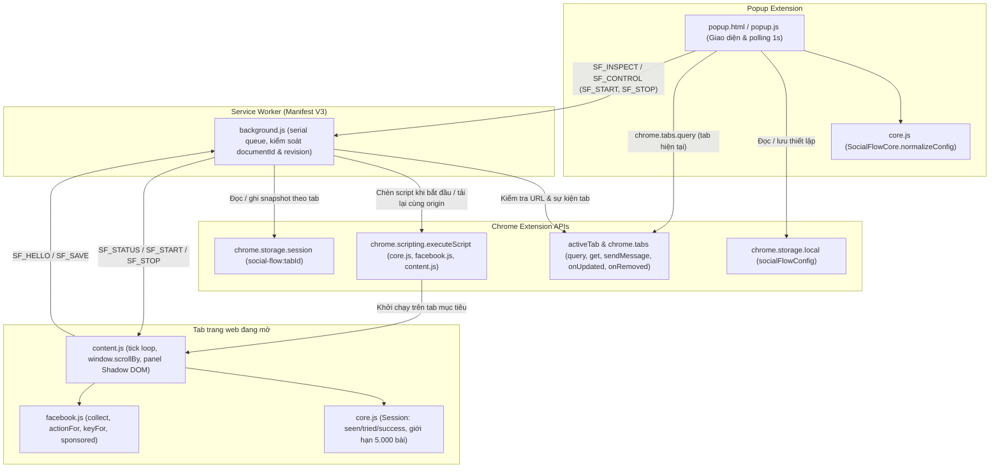
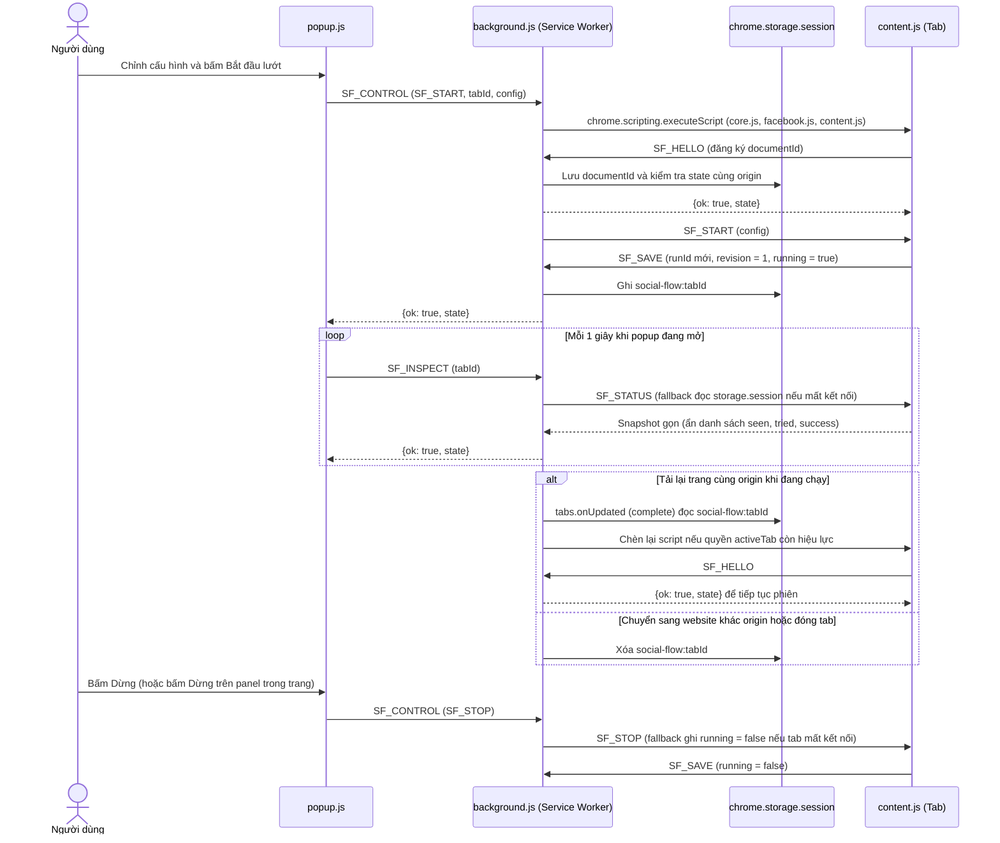
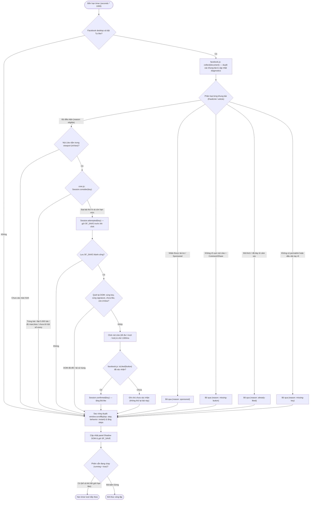

# Social Flow — Tự lướt & Like · v0.1.2


-405345)


Extension Chrome/Edge (Manifest V3) viết bằng JavaScript thuần, hỗ trợ tự cuộn website và tự like bài viết trên Facebook desktop theo tần suất tùy chỉnh. Không cần cài Node.js hay chạy máy chủ để sử dụng.

---

## Hành vi đã chốt

- Tự cuộn website cho đến khi bạn bấm **Dừng** trong popup hoặc trên panel nổi (Shadow DOM) ở góc trái dưới của trang.
- **Không tự tạm dừng** khi chuyển tab, mất focus, rê chuột, gõ nội dung hoặc khi đạt giới hạn like.
- Hết giới hạn like: không bấm thêm like, **vẫn tiếp tục cuộn**.
- Đóng popup không làm dừng extension. Đóng tab hoặc trình duyệt kết thúc phiên.
- Tải lại cùng website (cùng `origin`) có thể khôi phục phiên nếu quyền `activeTab` của tab còn hiệu lực; chuyển sang website khác sẽ xóa trạng thái phiên cũ và cần bật lại.

---

## Cấu trúc kho mã nguồn

```text
.
├── extension/                    # Thư mục extension có thể nạp trực tiếp (Load unpacked)
│   ├── manifest.json             # Manifest V3 (activeTab, scripting, storage; Chrome 106+)
│   ├── background.js             # Service Worker: chèn script, hàng đợi tuần tự & lưu trạng thái theo tab
│   ├── core.js                   # SocialFlowCore: chuẩn hóa cấu hình, Session, chống trùng 5.000 bài, hạn mức
│   ├── facebook.js               # SocialFlowFacebook: nhận diện khung bài, cụm nút Like, lọc quảng cáo & định danh
│   ├── content.js                # Vòng lặp cuộn/like theo chu kỳ, xác nhận DOM và panel Dừng trong trang
│   ├── popup.html                # Giao diện popup tiếng Việt và mục Chẩn đoán nhận diện
│   ├── popup.js                  # Điều khiển popup, lưu cấu hình và polling trạng thái mỗi 1 giây
│   ├── popup.css                 # Kiểu giao diện popup
│   └── icons/                    # Biểu tượng extension (16.png, 48.png, 128.png)
├── tests/
│   ├── core.test.cjs             # Kiểm thử Session, tần suất, chống trùng & giới hạn (không cần dependency)
│   ├── content.test.cjs          # Kiểm thử vòng lặp content.js, dừng giữa chừng & DOM tái sử dụng (không cần dependency)
│   ├── worker.test.cjs           # Kiểm thử background.js: quyền sở hữu documentId, reload & đóng tab (không cần dependency)
│   ├── adapter.test.cjs          # Kiểm thử lọc host, nút comment/page-card của facebook.js (không cần dependency)
│   ├── facebook-dom.test.cjs     # Kiểm thử DOM Facebook chi tiết bằng jsdom (cần npm install)
│   └── browser.test.cjs          # Kiểm thử fixture trên Chromium bằng Playwright (không dùng tài khoản thật)
├── scripts/
│   └── package.py                # Đóng gói file .zip phát hành và tự kiểm tra manifest, tham chiếu file & icon
├── docs/
│   └── superpowers/
│       ├── specs/2026-10-21-social-flow-design.md
│       └── plans/2026-10-21-social-flow.md
├── package.json                  # Script kiểm thử (npm test, npm run test:browser)
├── TEST-REPORT.md                # Báo cáo kết quả kiểm chứng bản 0.1.2
└── README.md
```

---

## Kiến trúc hệ thống

Extension gồm 3 ngữ cảnh tách biệt theo chuẩn Manifest V3: **Popup UI** (`popup.html` / `popup.js`), **Service Worker** (`background.js`), và **Content Scripts** (`core.js`, `facebook.js`, `content.js`) chỉ được chèn vào tab khi người dùng chủ động bấm bắt đầu hoặc khi tab cùng origin tải lại trong phiên đang chạy.



---

## Vòng đời phiên chạy & chu kỳ xử lý

### 1. Luồng điều khiển phiên, dừng và khôi phục khi tải lại tab



### 2. Luồng xử lý từng lượt (`tick`) — lọc bài, xác nhận like và tiếp tục cuộn



---

## Cài trên Chrome hoặc Edge

Extension không yêu cầu chạy `npm install` hay máy chủ nền để sử dụng. Bạn có thể cài theo một trong hai cách sau:

### Cách 1: Nạp trực tiếp từ kho mã nguồn (Load unpacked)

1. Mở `chrome://extensions` (Chrome) hoặc `edge://extensions` (Edge).
2. Bật **Developer mode / Chế độ dành cho nhà phát triển**.
3. Chọn **Load unpacked / Tải tiện ích đã giải nén**.
4. Chọn trực tiếp thư mục `extension/` bên trong kho mã nguồn này (nơi chứa `extension/manifest.json`).
5. Ghim **Social Flow** trong menu tiện ích, mở Facebook và đăng nhập như bình thường, rồi bấm biểu tượng Social Flow.
6. Chỉnh cấu hình và bấm **Bắt đầu lướt**.

### Cách 2: Đóng gói và cài từ file `.zip` phát hành

1. Tạo file `.zip` phát hành từ kho mã nguồn (xem mục [Đóng gói bản phát hành](#đóng-gói-bản-phát-hành)):
   ```powershell
   python scripts/package.py test-output/Social-Flow-Chrome-v0.1.2.zip
   ```
2. Giải nén toàn bộ file `Social-Flow-Chrome-v0.1.2.zip`, ví dụ vào `C:\dev\Social-Flow`.
3. Mở `chrome://extensions` (Chrome) hoặc `edge://extensions` (Edge) và bật **Developer mode / Chế độ dành cho nhà phát triển**.
4. Chọn **Load unpacked / Tải tiện ích đã giải nén** và chọn thư mục vừa giải nén (`manifest.json` nằm ngay thư mục gốc của gói giải nén).
5. Ghim **Social Flow**, mở website hoặc Facebook, chỉnh cấu hình và bấm **Bắt đầu lướt**.

> Không chọn trực tiếp file `.zip` khi nạp tiện ích và không cần chạy `npm install` để cài extension.

---

## Thiết lập

| Mục | Mặc định | Khoảng hợp lệ | Ý nghĩa |
| --- | --- | --- | --- |
| Khoảng nghỉ | 3 giây | 1 – 120 giây | Khoảng cách giữa các lượt; lượt có like cần thêm thời gian xác nhận (1.300 ms) |
| Mỗi lần cuộn | 450 px | 100 – 1.000 px | Độ dài cuộn trang chính (`window.scrollBy`) |
| Cứ mỗi | 10 bài | 1 – 1.000 bài | Thử like bài đủ điều kiện thứ 10, 20, 30... |
| Tối đa mỗi phiên | 5 | 0 – 10.000 | Giới hạn **lượt thử like**, bao gồm lượt chưa xác nhận được |
| Tự like | Bật | Bật / Tắt | Chỉ áp dụng Facebook desktop |

Cấu hình được khóa khi đang chạy. Muốn đổi, bấm **Dừng** rồi thay đổi và bấm **Bắt đầu lướt**; thao tác này tạo phiên mới và đặt lại bộ đếm. Đặt giới hạn `0` hoặc bỏ chọn **Tự like** để chỉ cuộn.

**Bài đủ điều kiện**: bài chưa like, nhận diện được định danh (đường dẫn cố định hoặc dấu vân tay nội dung đủ rõ) và cụm nút Like của bài (nằm cạnh nút Bình luận/Chia sẻ, không có nút Trả lời của bình luận), không bị nhận diện là quảng cáo, và nút Like đã đi vào vùng nhìn thấy. Bài đã tính trong phiên không được tính lại. Vì vậy số “Bài hợp lệ” có thể thấp hơn số bài bạn nhìn thấy.

“Đã like” chỉ tăng khi giao diện xác nhận (`aria-pressed="true"`, `aria-selected="true"` hoặc nhãn đã thích/bỏ thích). Extension không bấm lại bài chưa xác nhận; lượt thử vẫn tính vào giới hạn. Nếu nhiều bài đồng thời xuất hiện, mỗi lượt xử lý chỉ bấm tối đa một Like.

---

## Phạm vi hỗ trợ và giới hạn thực tế

- **Facebook desktop:** `www.facebook.com`, `web.facebook.com`, `facebook.com`; nhãn thao tác tiếng Việt/Anh. Bản v0.1.2 chưa được xác minh trên một tài khoản Facebook thật. Facebook có nhiều phiên bản giao diện, nên có thể chỉ cuộn mà chưa nhận diện được nút Like. Khi không rõ nút nào thuộc bài, extension bỏ qua.
- **Website khác:** tự cuộn trang chính; chưa tự like trên Instagram, TikTok, X, LinkedIn, Reddit. Khung cuộn riêng bên trong trang, Reels và trình phát video không nằm trong phạm vi bản này.
- Quảng cáo chỉ bị bỏ qua khi nhận diện được nhãn tài trợ (`Sponsored` / `Được tài trợ`). Không bảo đảm phát hiện nhãn bị chia nhỏ hoặc thay đổi cấu trúc.
- Chrome/Edge có thể làm chậm timer, đóng băng hoặc loại bỏ tab nền. Không có logic tự pause trong extension, nhưng không thể bảo đảm tốc độ cuộn khi tab ẩn hoặc máy ngủ.
- Tối đa nhận diện 5.000 bài trong một phiên; sau ngưỡng này tiếp tục cuộn và không thử thêm like để tránh tính trùng.
- Mỗi tab có phiên riêng. Muốn dừng một tab đang chạy, quay lại tab đó và bấm **Dừng** hoặc đóng tab.

---

## Khi chỉ cuộn mà chưa like

Kiểm tra **Tự like** đã bật, giới hạn lớn hơn `0`, đúng Facebook desktop và giao diện tiếng Việt/Anh. Xem số **Bài hợp lệ** có tăng không và mở mục **Chẩn đoán nhận diện** trong popup để xem chi tiết:

- Số khung bài (`frames`), số nút Like tìm thấy (`buttons`), số bài đủ điều kiện (`eligible`), số nút trong màn hình (`visible`).
- Số bài bị bỏ qua theo nguyên nhân: thiếu nút (`missingButton`), thiếu định danh (`missingKey`), đã có cảm xúc (`alreadyLiked`) hoặc quảng cáo (`sponsored`).

Nếu số bài hợp lệ luôn bằng `0`, bộ nhận diện chưa tương thích giao diện hiện tại; cần chỉnh `extension/facebook.js` theo DOM thực tế. Không tăng tần suất để khắc phục lỗi nhận diện.

---

## Quyền và dữ liệu

Chỉ dùng 3 quyền tối thiểu: `activeTab`, `scripting`, `storage`. Extension chỉ được truy cập tab khi bạn chủ động mở tiện ích.

- Không yêu cầu mật khẩu, không đọc cookie/token, không gọi API Facebook riêng.
- Không gửi nội dung bài viết ra ngoài và không tải mã từ máy chủ.
- Thiết lập lưu trong trình duyệt (`chrome.storage.local` dưới khóa `socialFlowConfig`); định danh bài đã xử lý và thống kê lưu tạm trong phiên trình duyệt (`chrome.storage.session` dưới khóa `social-flow:<tabId>`).
- Thống kê **Chẩn đoán nhận diện** chỉ lưu số đếm, không chứa nội dung bài viết hay tên tác giả.

---

## Phát triển, kiểm thử & đóng gói

### Vai trò các module chính

- `extension/core.js`: `SocialFlowCore` — chuẩn hóa cấu hình, đếm bài, chống trùng tối đa 5.000 định danh, giới hạn lượt thử.
- `extension/facebook.js`: `SocialFlowFacebook` — nhận diện khung bài (`FeedUnit`, `role="feed"`, `role="article"`), cụm nút thao tác, lọc quảng cáo và định danh bài.
- `extension/content.js`: vòng lặp cuộn/like (`tick`), xác nhận DOM sau click, đồng bộ trạng thái và panel Dừng (Shadow DOM).
- `extension/background.js`: chèn script theo tab, xếp hàng xử lý tuần tự (`serial`), lưu/khôi phục snapshot theo `documentId` và `revision`.
- `extension/popup.html`, `popup.js`, `popup.css`: giao diện tiếng Việt, polling trạng thái và bảng Chẩn đoán nhận diện.

### Chạy kiểm thử

Kiểm thử logic lõi không cần cài dependency (chỉ cần Node.js 20+, chạy 4 tệp / 22 kiểm thử):

```powershell
node --test tests/core.test.cjs tests/content.test.cjs tests/worker.test.cjs tests/adapter.test.cjs
```

Chạy đầy đủ bộ kiểm thử logic + DOM fixture (31 kiểm thử; `tests/facebook-dom.test.cjs` cần `jsdom` trong `devDependencies`):

```powershell
npm install
npm test
```

Kiểm thử fixture trên Chromium bằng Playwright (không dùng tài khoản Facebook thật):

```powershell
npm install
npx playwright install chromium
npm run test:browser
```

Xem `TEST-REPORT.md` để biết chính xác phần đã được chạy trong lần bàn giao này. Không có bộ kiểm thử nào tự like trên tài khoản thật.

### Đóng gói bản phát hành

Script `scripts/package.py` đóng gói toàn bộ `extension/` ra thư mục gốc của file `.zip` (kèm `HUONG-DAN.md`, `KIEM-THU.md` và mã nguồn đầy đủ trong `development/`), đồng thời tự kiểm tra CRC, `manifest.json`, tham chiếu file trong `popup.html` và kích thước icon (`16x16`, `48x48`, `128x128`).

Yêu cầu Python 3 và thư viện `Pillow`:

```powershell
pip install pillow
python scripts/package.py test-output/Social-Flow-Chrome-v0.1.2.zip
```

> Lưu ý: đặt đường dẫn tệp đầu ra trong `test-output/` (đã được loại trừ khi đóng gói và nằm trong `.gitignore`) hoặc ngoài thư mục kho mã nguồn để tránh việc tệp `.zip` tự đóng gói chính nó. Trên Windows không bật UTF-8 mặc định, có thể chạy kèm `PYTHONUTF8=1`.

---

## Cập nhật 0.1.2

Dừng bản cũ, thay file trong thư mục đã cài, bấm nút tải lại của Social Flow ở `chrome://extensions`, sau đó tải lại tab Facebook (`F5`). Kiểm tra popup hiển thị `v0.1.2`. Nếu tải bản mới sang thư mục khác, gỡ bản cũ rồi **Load unpacked** thư mục mới để không chạy hai extension cùng lúc.

- Bộ nhận diện bổ sung khung `FeedUnit`, chữ **Thích/Like** nhìn thấy khi `aria-label` khác, cụm nút có nhiều lớp bao (tới 8 tầng), đường dẫn ảnh có `fbid`.
- Khi không có permalink, chỉ dùng dấu vân tay băm từ tác giả và vùng nội dung bài (`data-ad-preview="message"`, `data-ad-rendering-role="story_message"`); không lưu văn bản bài. Hai bài cùng tác giả, cùng nội dung có thể được gộp thành một và bỏ qua like trùng. Bài không có đủ tín hiệu vẫn bị bỏ qua.
- Mở **Chẩn đoán nhận diện** để thấy: số khung bài, nút Like, bài hợp lệ, nút trong màn hình; số bị bỏ qua vì thiếu nút, thiếu định danh, đã có cảm xúc hoặc quảng cáo. Thống kê này không chứa nội dung bài hay tên tác giả.
- Gói cài `.zip` chứa mã nguồn và kiểm thử đầy đủ trong thư mục `development/`.

---

## Tài liệu tham khảo

- https://developer.chrome.com/docs/extensions/develop/concepts/activeTab
- https://developer.chrome.com/docs/extensions/develop/concepts/content-scripts
- https://developer.chrome.com/blog/timer-throttling-in-chrome-88/
